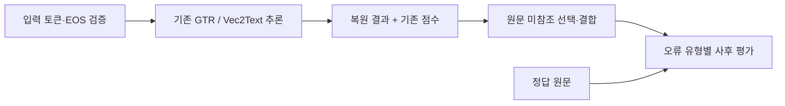

# Fidelity-Guided Multi-View Text Reconstruction
## from Exposed Overlapping RAG Embeddings

중첩된 임베딩의 여러 복원 결과를 선택·결합하고, 입력 조건과 변경 영향을 분석한 연구입니다.

[논문 PDF](paper/ICISC_2026_paper__52.pdf) · [채용용 한 쪽 소개](docs/PROJECT_SUMMARY.ko.md) · [구현 안내](docs/IMPLEMENTATION.md) · [실험과 결과](docs/EXPERIMENTS.md) · [English](README.en.md)

**연구 상태:** ICISC 2026 투고·심사 중 — 연구자 제공 정보, 2026-10-18 기준.

## 30초로 읽는 연구

- **문제:** 서로 겹치는 텍스트 구간의 임베딩을 각각 역복원하면, 같은 원문 부분에 여러 불완전한 출력이 생깁니다. 단순 연결은 중복과 삽입·삭제에 따른 경계 어긋남을 남깁니다.
- **접근:** 공개 사전학습 Vec2Text의 출력과 기존 임베딩 일치도 점수를 활용해, 중첩 부분을 어느 출력에서 가져올지 결정하고 결과를 결합했습니다.
- **분석:** 동일한 복원 결과에서 선택 규칙의 효과를 비교하고, 복원율과 삽입·삭제·치환·완전일치를 분리해 변경 영향을 검토했습니다.

## 대표 결과

**동일한 60개 평가 구간 × 구간당 136개 = 8,160개 정답 토큰 위치**를 평가했습니다. 각 구간의 같은 8개 Top-1 복원 결과, 좌표·길이·빈 위치·동률 처리를 고정하고 **선택 규칙만** 바꾼 비교입니다.

| 고정 좌표 방식 | 정확히 맞춘 정답 위치 | 토큰 복원율 | 총 편집량 |
| --- | ---: | ---: | ---: |
| FC–L: 앞쪽 출력 우선 | 7,823 / 8,160 | 95.87% | 415 |
| FC–F: 기존 점수가 높은 출력 선택 | 8,045 / 8,160 | **98.59%** | **137** |

**+222개 정답 위치, +2.72%p, 편집량 278개 감소**를 확인했습니다. 동일 표본에 대한 **사후 탐색 분석**입니다. 복원율은 정답 토큰 위치의 회수율이며, 문서 전체를 완벽히 복원한 비율과 다릅니다.

정렬형 CP–F는 FC–F보다 16개 위치를 더 복원했지만, 삽입은 22→41개, 총 편집량은 137→140개로 늘고 완전일치 구간은 38/60→35/60으로 줄었습니다. 이는 경계 추정·길이 처리도 달라지는 **전체 방식 비교**입니다. [조건·오류 유형·한계 보기](docs/EXPERIMENTS.md)

## 구현과 문제 해결

| 관찰한 문제 | 프로젝트에서 추가한 처리 | 읽어 볼 코드 |
| --- | --- | --- |
| 원문 token slice와 문자열의 독립 재토큰화가 달라질 수 있음 | 토큰 ID 일치, EOS/PAD, 최대 32개 입력 위치를 검증하고 안정적인 입력을 선별 | [chunking.py](src/overlap_poc/chunking.py#L226), [reconstruction.py](src/overlap_poc/reconstruction.py#L229) |
| 중첩 복원 결과의 중복·경계 어긋남 | 고정 좌표 선택 및 제한된 suffix/prefix 정렬·결합, 동률·짧은 출력·삼중 관측 처리 | [stage5d_assembly.py](src/overlap_poc/stage5d_assembly.py#L163), [stage6a_source_free_assembly.py](src/overlap_poc/stage6a_source_free_assembly.py#L235) |
| 복원율만 보면 추가 삽입을 놓칠 수 있음 | 복원율과 삽입·삭제·치환·편집량·구간 완전일치를 별도 평가 | [diagnostics.py](src/overlap_poc/diagnostics.py), [평가 함수](src/overlap_poc/stage5d_assembly.py#L200) |
| 서로 다른 실행의 중간 결과를 잘못 재사용할 수 있음 | 입력·모델·설정 fingerprint 및 완료 key의 순서·길이 검증 | [stage6c_strong.py](src/overlap_poc/stage6c_strong.py#L149) |

기존 Vec2Text가 제공하는 후보 생성·교정·beam 검색·cosine 점수를 재사용했습니다. 프로젝트의 추가 입력 검증·선택·결합·평가와 구분해 읽을 수 있도록 [함수별 구현 안내](docs/IMPLEMENTATION.md)를 정리했습니다.



결합은 복원 결과·점수·알려진 구간 배치만 사용합니다. 원문과 oracle를 사용하는 분석은 사후 평가·진단입니다.

## 담당 경험과 사용 기술

연구를 직접 수행하며 기존 Vec2Text의 입력·추론 구조를 확인하고, 복원 결과의 선택·결합과 비교 평가를 다뤘습니다. 입력 표현 차이와 복원 오류를 구분하고, 결합 규칙이 오류 유형에 미치는 영향을 분석했습니다.

| 기술 | 실제 사용 방식 |
| --- | --- |
| Python | 입력 검증·선택·결합·평가 파이프라인 |
| Vec2Text | 공개 사전학습 역복원 모델과 기존 점수 활용 |
| PyTorch / CUDA | PyTorch 기반 GPU 추론(CUDA 환경) |
| Transformers / tokenizers | 모델·토큰화 호출, offsets·EOS/PAD·입력 길이 검증 |
| Hugging Face datasets | revision을 지정한 BEIR/Natural Questions 로드 |
| NumPy / YAML / JSON | 임베딩 배열·설정·결과·중간 상태 저장 |
| Linux | 연구 실험 실행 환경 |

기존 소프트웨어의 입력·호출 계약 이해, 오류 원인 구분, 기능 변경의 영향 검증을 보여 주는 연구 경험입니다. 자세한 설명은 [채용용 소개](docs/PROJECT_SUMMARY.ko.md)에 담았습니다.

## 저장소 둘러보기

```text
paper/ICISC_2026_paper__52.pdf   제공된 논문 PDF
docs/                          연구 소개·구현·실험·재현 범위
src/overlap_poc/                원본 핵심 코드와 필요한 내부 의존 모듈
scripts/                       선별한 기존 실험 실행 진입점
configs/                       관련 기존 설정·평가 프로토콜
tests/                         선별한 기존 합성 입력 중심 테스트
results/summary.json            네 방식의 집계 수치와 조건
results/summary.csv             같은 집계 수치의 표 형식
tools/verify_summary.py         산술·CSV·PDF·복사본 무결성 확인
SOURCE_MANIFEST.json            복사한 원본 파일의 상대경로·SHA-256
```

**GPU·설치 없이 집계 수치 확인:**

```bash
python3 tools/verify_summary.py
```

위 명령은 집계표의 산술·파일 일치를 확인합니다. 모델 추론이나 논문 실험의 재실행은 아닙니다.

## 재현 범위와 한계

- 공개본에는 코드·관련 설정·기존 테스트와 집계 수치를 담았습니다. 원시 corpus, 실제 복원문·token arrays, 임베딩, 모델 가중치, 중간 checkpoint는 포함하지 않았습니다.
- 이 저장소만으로 논문의 end-to-end GPU 실험이나 원시 출력의 재채점을 재현할 수는 없습니다. 원본 runner의 일부 설정은 공개하지 않은 frozen artifact를 참조합니다.
- 이번 공개 준비에서는 연구 코드·기존 테스트·GPU 추론을 실행하지 않았습니다. 기존 테스트의 존재를 이번 통과 결과로 표시하지 않습니다.
- 결과는 특정 GTR/Vec2Text 조합과 토큰화가 안정적인 영어 NQ 구간에 한정됩니다. 새 역복원 모델·신뢰도 모델을 학습한 결과가 아닙니다.
- overlap/no-overlap의 8개 대 5개 벡터 비교는 동일 계산 예산의 비교가 아닙니다.

[환경 기록·테스트 범위·재현 수준](docs/REPRODUCIBILITY.md) · [자료 범위와 출처](NOTICE.md)
